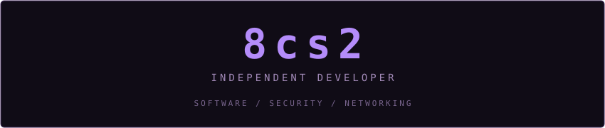

<div align="center">
  
</div>

```ini
[ user_information ]

focus     = software & cybersecurity
stack     = c++, py, js, rust, php
languages = ru / en / pt-br
```

<div align="center">


---

`security is a process, not a product.`

</div>
